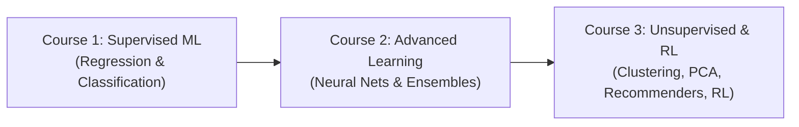

# Machine Learning Specialization (Andrew Ng / DeepLearning.AI)

Comprehensive lecture notes, study summaries, and interactive lab assignments from the industry-standard 3-course Machine Learning Specialization by Andrew Ng (DeepLearning.AI / Stanford).

---

## 🧭 Course Overview

The specialization is divided into three core courses covering supervised learning, neural networks, unsupervised methods, and reinforcement learning:

---

## 📚 Curriculum Breakdown & Study Assets

### Course 1: Supervised Machine Learning — Regression & Classification
Foundational supervised algorithms, cost functions, gradient descent, and regularized classification.

| Topic | Study Notes (PDF) | Practical Lab (Jupyter Notebook) |
| :--- | :--- | :--- |
| **Linear Regression** | [Linear_Regression.pdf](notes/Linear_Regression.pdf) | [Linear_Regression.ipynb](assignments/Linear_Regression.ipynb) |
| **Gradient Descent** | [Gradient_Descent.pdf](notes/Gradient_Descent.pdf) | — |
| **Logistic Regression** | [Logistic_Regression.pdf](notes/Logistic_Regression.pdf) | [Logistic_Regression.ipynb](assignments/Logistic_Regression.ipynb) |

---

### Course 2: Advanced Learning Algorithms
Multi-class neural networks, decision trees, tree ensembles, and machine learning diagnostic advice.

| Topic | Study Notes (PDF) | Practical Lab (Jupyter Notebook) |
| :--- | :--- | :--- |
| **Neural Networks** | [Neural_Networks.pdf](notes/Neural_Networks.pdf) | [Neural_Networks_for_Multiclass_Classification.ipynb](assignments/Neural_Networks_for_Multiclass_Classification.ipynb) |
| **Multiclass Classification** | — | [Multiclass_Classification_and_Neural_Networks.ipynb](assignments/Multiclass_Classification_and_Neural_Networks.ipynb) |
| **Applying ML Diagnostics** | — | [Advice_for_Applying_Machine_Learning.ipynb](assignments/Advice_for_Applying_Machine_Learning.ipynb) |
| **Decision Trees** | [Decision_Trees.pdf](notes/Decision_Trees.pdf) | [Decision_Trees.ipynb](assignments/Decision_Trees.ipynb) |
| **Tree Ensembles & Random Forests**| [Tree_Ensembles.pdf](notes/Tree_Ensembles.pdf) | — |

---

### Course 3: Unsupervised Learning, Recommenders & Reinforcement Learning
Clustering, dimensionality reduction, anomaly detection, recommender systems, and deep Q-learning.

| Topic | Study Notes (PDF) | Practical Lab (Jupyter Notebook) |
| :--- | :--- | :--- |
| **K-Means Clustering** | [Clustering.pdf](notes/Clustering.pdf) | [K-means_Clustering.ipynb](assignments/K-means_Clustering.ipynb) |
| **Principal Component Analysis** | [Principle_Component_Analysis.pdf](notes/Principle_Component_Analysis.pdf) | — |
| **Anomaly Detection** | [Anomaly_Detection.pdf](notes/Anomaly_Detection.pdf) | [Anomaly_Detection.ipynb](assignments/Anomaly_Detection.ipynb) |
| **Collaborative Filtering** | [Recommender_Systems.pdf](notes/Recommender_Systems.pdf) | [Collaborative_Filtering_Recommender_Systems.ipynb](assignments/Collaborative_Filtering_Recommender_Systems.ipynb) |
| **Content-Based Filtering** | — | [Content-based_Filtering_Recommender_Systems.ipynb](assignments/Content-based_Filtering_Recommender_Systems.ipynb) |
| **Reinforcement Learning (DQN)** | [Reinforcement_Learning.pdf](notes/Reinforcement_Learning.pdf) | [Reinforcement_Learning.ipynb](assignments/Reinforcement_Learning.ipynb) |

---

## 🗂️ Folder Structure
- `notes/`: PDF summaries with mathematical derivations, algorithm steps, and diagrams.
- `assignments/`: Complete, runnable Jupyter Notebook implementations of all lab assignments.
